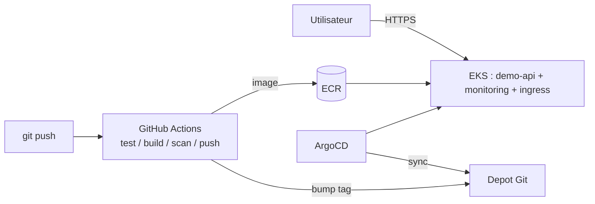

# GitOps Platform on AWS EKS

Plateforme Kubernetes **production-grade** sur AWS, provisionnee en
Infrastructure as Code et exploitee en **GitOps** : l'etat du cluster est
entierement decrit dans Git, et ArgoCD se charge de le faire converger en
continu.


---

## Ce que ce projet demontre

- **Infrastructure as Code** : un cluster EKS complet (VPC, subnets, node group, IAM/IRSA) decrit en Terraform, 100 % reproductible, zero clic console.
- **GitOps** : ArgoCD en pattern *app-of-apps*. Deployer un nouveau service = commiter un fichier YAML.
- **CI/CD securise** : build, tests, scan de vulnerabilites (Trivy), push ECR via **OIDC** (aucune cle AWS stockee), puis mise a jour declarative du cluster.
- **Observabilite** : stack Prometheus + Grafana deployee elle aussi en GitOps.
- **Securite** : conteneur non-root, filesystem en lecture seule, capabilities droppees, images ECR immuables scannees au push.

## Architecture



Schema detaille et choix d'architecture : [`docs/architecture.md`](docs/architecture.md).

## Structure du depot

```
gitops-eks-platform/
├── terraform/              # VPC + EKS + ECR + bootstrap ArgoCD
├── gitops/apps/            # Applications ArgoCD (app-of-apps)
├── apps/demo-api/          # Application de demo + manifests Kustomize
│   └── k8s/
│       ├── base/           # Manifests communs
│       └── overlays/       # Surcharges dev / prod
├── .github/workflows/      # Pipelines CI (app) et validation Terraform
└── docs/                   # Documentation d'architecture
```

## Prerequis

- [Terraform](https://developer.hashicorp.com/terraform/install) >= 1.5
- [AWS CLI](https://aws.amazon.com/cli/) configure (`aws configure`)
- [kubectl](https://kubernetes.io/docs/tasks/tools/) et [Helm](https://helm.sh/)
- Un compte AWS (ce projet cree des ressources **payantes**, voir plus bas)

## Deploiement

### 1. Provisionner l'infrastructure

```bash
cd terraform
cp terraform.tfvars.example terraform.tfvars   # adapter les valeurs
terraform init
terraform apply
```

Terraform cree le VPC, le cluster EKS, le registre ECR, puis installe ArgoCD
et l'application racine. ArgoCD prend alors le relais et deploie
automatiquement le reste depuis le dossier `gitops/`.

### 2. Se connecter au cluster

```bash
aws eks update-kubeconfig --region eu-west-3 --name gitops-eks
kubectl get nodes
```

### 3. Acceder a l'interface ArgoCD

```bash
# Mot de passe admin initial
kubectl -n argocd get secret argocd-initial-admin-secret \
  -o jsonpath='{.data.password}' | base64 -d

# Acces local a l'UI
kubectl -n argocd port-forward svc/argocd-server 8080:80
# -> http://localhost:8080  (login: admin)
```

## Cycle de vie applicatif (GitOps)

1. Modifier le code dans `apps/demo-api/` et pousser.
2. La CI teste, construit, scanne et pousse l'image sur ECR.
3. La CI met a jour le tag dans `overlays/prod/kustomization.yaml` et commite.
4. ArgoCD detecte le commit et deploie la nouvelle version — sans intervention.

Un rollback se fait par un simple `git revert`.

## Estimation de cout

Ordre de grandeur en region `eu-west-3`, hors Free Tier :

| Ressource | Cout indicatif |
|---|---|
| Control plane EKS | ~0,10 $/h (~73 $/mois) |
| 2 x noeuds `t3.medium` | ~60 $/mois |
| NAT Gateway | ~32 $/mois + trafic |
| Load Balancer (NLB) | ~16 $/mois + trafic |
| **Total approximatif** | **~180 $/mois** |

> A **detruire apres demonstration** pour eviter toute facturation.

## Nettoyage

```bash
# Laisser ArgoCD supprimer les charges applicatives d'abord
kubectl delete -n argocd applications --all

# Puis detruire l'infrastructure
cd terraform
terraform destroy
```

## Pistes d'amelioration

- Remote state Terraform (S3 + verrouillage).
- `cert-manager` + DNS externe pour du TLS automatique.
- Argo CD Image Updater pour supprimer l'etape de bump manuel.
- Policies OPA/Gatekeeper et Pod Security Standards.
