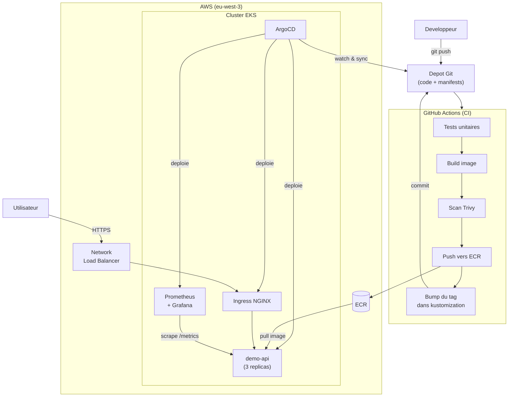

# Architecture

## Vue d'ensemble

## Principe GitOps

Le depot Git est la **source unique de verite**. On ne fait jamais de
`kubectl apply` manuel : toute modification de l'etat du cluster passe par un
commit. ArgoCD compare en continu l'etat reel du cluster avec l'etat decrit
dans Git et corrige automatiquement toute derive (`selfHeal`).

## Flux de deploiement d'une nouvelle version

1. Le developpeur pousse du code applicatif.
2. La CI teste, construit l'image, la scanne (Trivy) et la pousse sur ECR.
3. La CI met a jour le tag d'image dans `kustomization.yaml` et commite.
4. ArgoCD detecte le commit et resynchronise le cluster vers la nouvelle version.

Separer "construire l'image" (CI) de "deployer" (ArgoCD) rend les deploiements
tracables, reversibles (un simple `git revert`) et auditables.

## Choix d'architecture

| Decision | Raison |
|---|---|
| Modules Terraform officiels (`vpc`, `eks`) | Maintenus par la communaute, evitent de reinventer la roue |
| IRSA active | Permissions IAM fines par ServiceAccount, sans cles statiques |
| OIDC pour la CI | Aucune cle AWS longue duree stockee dans GitHub |
| Un seul NAT Gateway | Compromis cout assume pour un environnement de demo |
| Images ECR immuables + scan on push | Tracabilite et securite de la supply chain |
| App-of-apps | Ajouter un service = commiter un fichier YAML |
